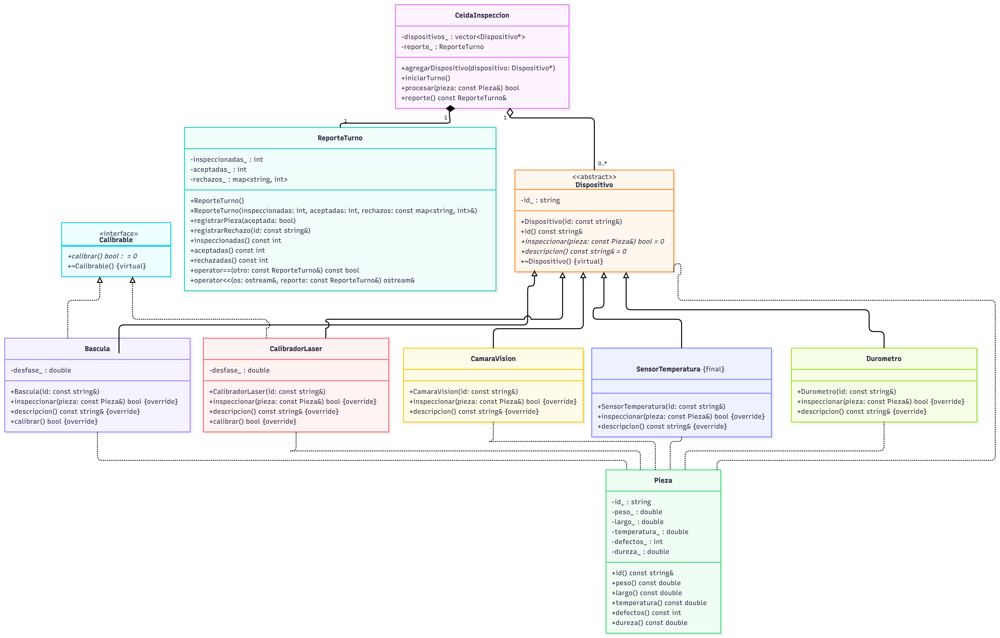

# Celda Robótica de Inspección de Calidad

Proyecto del Parcial 3 de Programación Orientada a Objetos.

## 1. Equipo

| Integrante | Matrícula | Nombre | Usuario de GitHub | Clase |
| --- | --- | --- | --- | --- |
| 1 | 25218 | Néstor Hiram López Valdovinos | nestor-lopez-07 | Bascula |
| 2 | Pendiente | Brayan Alberto | Pendiente | CalibradorLaser |
| 3 | Pendiente | Daniel | Pendiente | CamaraVision |
| 4 | 25128 | Diego | Pendiente | SensorTemperatura |
| 5 | Pendiente | Arturo | Pendiente | ReporteTurno |
| 6 | Pendiente | Jorge | Jorge-Sadurni | Durometro |

## 2. Cómo compilar y ejecutar

Desde la raíz del repositorio:

```powershell
g++ -Wall -Wextra -std=c++17 -Iinclude src/*.cpp -o celda.exe
.\celda.exe
```

Los dos experimentos se compilan y ejecutan por separado:

```powershell
g++ -Wall -Wextra -std=c++17 experimentos/memoria.cpp -o memoria.exe
.\memoria.exe

g++ -Wall -Wextra -std=c++17 experimentos/destructores.cpp -o destructores.exe
.\destructores.exe
```

## 3. Contrato de `Dispositivo` y `Calibrable`

**¿Qué errores dio el compilador al compilar el repositorio base y qué significaba cada uno?**

- `class Dispositivo` no tenía el miembro `descripcion`: `iniciarTurno()` llama a `d->descripcion()` y ese método no existía.
- `class Calibrable` no tenía el miembro `calibrar`: `iniciarTurno()` llama a `c->calibrar()` y ese método no existía.
- El tipo fuente no era polimórfico: `dynamic_cast<Calibrable*>(d)` exige que `Dispositivo` tenga al menos un método virtual.
- Las clases `CeldaInspeccion.h` y `ReporteTurno` estaban incompletas, pero la celda las utiliza.

**¿Qué métodos agregaron a Dispositivo? ¿Cuáles son virtuales puros, cuáles son const y por qué el destructor es virtual?**

- `inspeccionar(const Pieza&) const`: es virtual puro y `const`. Un dispositivo no modifica la pieza ni su propio estado al medir. Recibe `const&` para no copiar.
- `descripcion() const`: es virtual puro y `const`, ya que solo consulta información.
- Al tener métodos virtuales puros, la clase `Dispositivo` es abstracta y no se puede crear un objeto genérico.
- El destructor es virtual para que `delete` mediante un `Dispositivo*` llame al destructor de la clase derivada. Además, hace que la clase sea polimórfica y permite usar `dynamic_cast`.

**¿Qué agregaron a Calibrable y por qué no tiene atributos?**

- Agregamos `virtual bool calibrar() = 0` y un destructor virtual.
- Es una capacidad (interfaz), no un objeto con estado. El desfase pertenece a cada dispositivo concreto, así que cada uno lo guarda y lo corrige a su manera.

## 4. Cálculo a mano del reporte

Turno de 12 piezas, con los desfases ya corregidos por la calibración. `Bascula` mide `peso + desfase` y el desfase queda en `0.0`; `CalibradorLaser` mide `largo + desfase` y el desfase queda en `0.0`.

| Pieza | B-01 | L-01 | V-01 | T-01 | D-01 | Resultado |
| --- | --- | --- | --- | --- | --- | --- |
| P-01 | ACEPTA | ACEPTA | ACEPTA | ACEPTA | ACEPTA | ACEPTADA |
| P-02 | ACEPTA | ACEPTA | ACEPTA | ACEPTA | ACEPTA | ACEPTADA |
| P-03 | RECHAZA | ACEPTA | ACEPTA | ACEPTA | ACEPTA | RECHAZADA |
| P-04 | ACEPTA | ACEPTA | ACEPTA | ACEPTA | ACEPTA | ACEPTADA |
| P-05 | ACEPTA | RECHAZA | ACEPTA | ACEPTA | ACEPTA | RECHAZADA |
| P-06 | ACEPTA | ACEPTA | RECHAZA | ACEPTA | ACEPTA | RECHAZADA |
| P-07 | ACEPTA | ACEPTA | ACEPTA | RECHAZA | ACEPTA | RECHAZADA |
| P-08 | RECHAZA | RECHAZA | RECHAZA | ACEPTA | ACEPTA | RECHAZADA |
| P-09 | ACEPTA | ACEPTA | ACEPTA | ACEPTA | RECHAZA | RECHAZADA |
| P-10 | ACEPTA | ACEPTA | ACEPTA | ACEPTA | RECHAZA | RECHAZADA |
| P-11 | ACEPTA | ACEPTA | ACEPTA | RECHAZA | ACEPTA | RECHAZADA |
| P-12 | ACEPTA | ACEPTA | ACEPTA | ACEPTA | ACEPTA | ACEPTADA |

**Reporte esperado del equipo de 6:**

| Concepto | Cantidad |
| --- | ---: |
| Inspeccionadas | 12 |
| Aceptadas | 4 |
| Rechazadas | 8 |
| Rechazos B-01 | 2 |
| Rechazos D-01 | 2 |
| Rechazos L-01 | 2 |
| Rechazos T-01 | 2 |
| Rechazos V-01 | 2 |

El resultado coincide con las reglas del proyecto: P-01, P-02, P-04 y P-12 son aceptadas; las otras ocho piezas tienen al menos un rechazo. P-08 suma rechazos a B-01, L-01 y V-01.

**Contraste con el programa:**

La ejecución aún no pudo verificarse porque el repositorio conserva las clases y la celda incompletas. Cuando el programa esté implementado, se debe registrar aquí si coincidió al primer intento. Si aparece una diferencia, se documentará la pieza afectada, la causa y la corrección aplicada.

## 5. Diagrama de clases

El diagrama completo debe guardarse en la raíz como `diseno_solucion.png`. Debe incluir `Dispositivo` como clase abstracta, `Calibrable` como interfaz, herencia múltiple en `Bascula` y `CalibradorLaser`, composición entre `CeldaInspeccion` y `ReporteTurno`, agregación hacia `Dispositivo`, dependencia hacia `Pieza`, virtuales puros, destructor virtual, `override` y `SensorTemperatura` como `final`.



## 6. Documentación individual

| Integrante | Documentación de su clase | Rama del reto opcional |
| --- | --- | --- |
| Néstor Hiram López Valdovinos | `docs/25218/Bascula.md` | No |
| Brayan Alberto | `docs/<matrícula>/CalibradorLaser.md` | Pendiente |
| Daniel | `docs/<matrícula>/CamaraVision.md` | Pendiente |
| Diego | `docs/<matrícula>/SensorTemperatura.md` | Pendiente |
| Arturo | `docs/<matrícula>/ReporteTurno.md` | Pendiente |
| Jorge | `docs/<matrícula>/Durometro.md` | Pendiente |

Los resultados de los experimentos deben estar documentados en [docs/experimentos.md](docs/experimentos.md).

## 7. Prueba de extensibilidad

La prueba consistirá en crear una clase nueva que herede de `Dispositivo`, implementar `inspeccionar()` y `descripcion()`, crearla en `main` y agregarla con `celda.agregarDispositivo()`. No debe ser necesario modificar `CeldaInspeccion` ni `procesar()`: la celda solo trabaja con el contrato `Dispositivo` y ejecuta cada método por binding dinámico.

**Resultado esperado:**

- Archivos nuevos: un encabezado `include/*.h` y una implementación `src/*.cpp`.
- Archivo modificado: `main.cpp`, únicamente para crear y agregar el dispositivo.
- `CeldaInspeccion`: no debe modificarse.
- El reporte esperado puede cambiar durante la prueba, pero debe restaurarse antes de la entrega.

## 8. Reflexión del equipo

**¿Qué aprendimos en este proyecto?**

Aprenderemos a separar un contrato común de sus implementaciones concretas. El uso de herencia, métodos virtuales puros, `override`, herencia múltiple e interfaces permite que la celda inspeccione piezas sin conocer las clases concretas. También reforzaremos las relaciones de agregación y composición, el uso de referencias constantes y la importancia de verificar límites y desfases de calibración.

**¿Qué cambiaríamos de nuestro proceso de trabajo como equipo?**

Haríamos primero los contratos de `Dispositivo` y `Calibrable`, revisaríamos el diagrama antes de implementar y confirmaríamos el cálculo a mano antes de probar. Después, cada integrante trabajaría en su clase desde una rama o en archivos propios, haciendo `git pull` antes de comenzar y commits pequeños. Las modificaciones compartidas a `CeldaInspeccion` y `main` se harían avisando al equipo y verificando la compilación después de cada integración.
